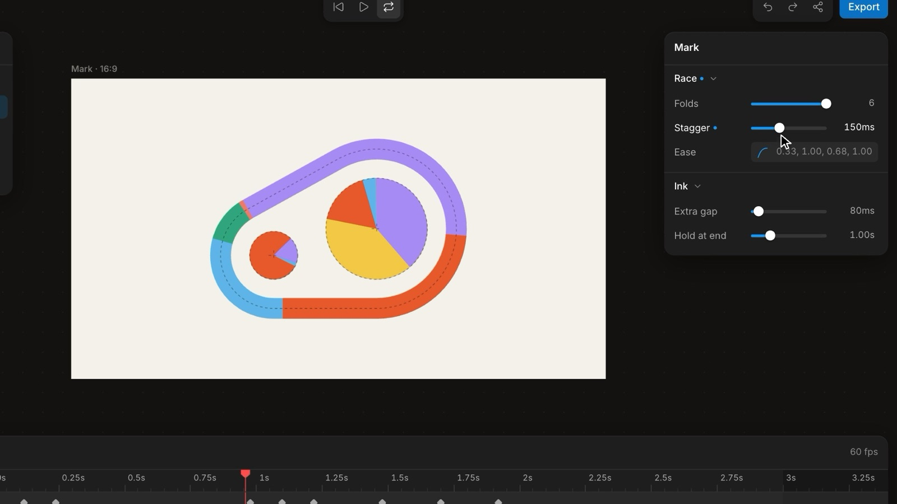

# Rueca

**Spin your prototype into a tool.**

[](https://github.com/rueca/rueca/releases/download/v0.1.0/rueca-demo.mp4)

<sub>▶ [Watch the 25-second video](https://github.com/rueca/rueca/releases/download/v0.1.0/rueca-demo.mp4)</sub>

A prototype needs two things: the thing you are designing, and a tool around it to
feel and tune it. Rueca is that tool — the inspector, timeline, layers,
presets, export and client view of a real design app — dropped in around any
prototype, in any runtime, installed component by component and kept up to date.

It ships three ways: an **agent skill** that teaches your coding agent to build the
harness properly, a **Claude Code plugin** that bundles it, and a **component
registry** for the kit itself.

**[Live site and example tools →](https://rueca.dev)**

## Install

**Claude Code** (recommended)

```
/plugin marketplace add rueca/rueca
/plugin install rueca@rueca
```

Then ask for a prototype, a playground or "a tool to tune this". Update with
`/plugin marketplace update`.

**Any agent** (Cursor, Codex, Copilot, Gemini… anything that reads the
[Agent Skills](https://agentskills.io) format)

```bash
npx skills add rueca/rueca
```

**Just the kit** (React 19 + Tailwind v4, via the shadcn CLI)

Needs a React project with Tailwind v4 that's already set up for shadcn. Starting fresh
with Vite? Follow [shadcn's Vite guide](https://ui.shadcn.com/docs/installation/vite)
first: it adds the `@` import alias and runs `npx shadcn@latest init`. Adding it to an existing app
that has no `components.json`? Don't run `init` there (it rewrites your main CSS): write the small
`components.json` from the [install guide](skills/rueca/references/install.md) instead.

```bash
npx shadcn@latest add https://rueca.dev/r/studio.json
```

Or one piece at a time — `theme`, `core`, `inspector`, `timeline`, `stage`, `layers`,
`scrub`, `color`, `palette`… Each pulls what it needs. The full list is at
[`/r/registry.json`](https://rueca.dev/r/registry.json). Files land in
your project (`components/studio/`), so you own them. Then add the theme to your main CSS
(its tokens apply only inside the tool, so your app's own variables and dark mode stay as they are)
and give the page a height, because `<Studio>` fills its parent:

```css
@import "./components/studio/theme.css";
html, body, #root { height: 100%; margin: 0; }
```

Re-run `add` with `--overwrite` to update a piece, `--diff` to preview the change first.

## How it works

```ts
// 1. Describe the knobs. This one schema is the inspector, defaults, undo,
//    presets, A/B, the share link and the JSON an engineer receives.
export const params = createParams(defineSchema({
  shape: folder('Shape', {
    count:  p.number(24, { min: 3, max: 96, step: 1, hint: 'How many dots.' }),
    radius: p.number(72, { min: 10, max: 140, unit: 'px' }),
    tint:   p.color('#5b8cff', { publish: true }),   // clients may change this one
  }),
}), { id: 'dots' })
```

```tsx
// 2. Plug in the artifact — Canvas, WebGL, three.js, React, or an iframe of anything.
<CanvasSurface params={params} clock={clock} draw={(ctx, { v, t }) => render(ctx, v, t)} />

// 3. Wrap it in a shell.
<Studio toolbar={<Toolbar … />} right={<Panel><Inspector params={params} /></Panel>}
        bottom={<Timeline clock={clock} lanes={lanes} />}>
  <Stage><Artboard width={390} height={844}>…</Artboard></Stage>
</Studio>
```

An existing prototype in another framework needs no rewrite — add the 2 KB bridge:

```html
<script src="studio-bridge.js"></script>
<script>studio.cssVars()  /* every value arrives as a CSS custom property */</script>
```

The full API is in [`docs/KIT.md`](docs/KIT.md).

## What's in this repo

| Path | What |
|---|---|
| `skills/rueca/` | The agent skill — a lean `SKILL.md` plus reference files it loads only when needed |
| `src/kit/` | The kit: schema, param store, clock, surfaces, inspector, timeline, layers, stage, palette |
| `src/shells/` | Example tools, each a different kind of instrument built from the same kit |
| `src/landing/` | The landing page |
| `src/site.config.ts` | The product's name, repo and URL — the one place they live |
| `public/studio-bridge.js` | The drop-in bridge |
| `.claude-plugin/` | Plugin and marketplace manifests (generated) |
| `registry.json` | Component registry (generated; built to `public/r/`) |
| `scripts/` | `sync.mjs` (regenerates derived files) and `qa.mjs` (headless contrast + console audit) |
| `research/` | The research behind the defaults: pro-tool patterns, prior art, QA findings |

## Develop

```bash
npm install
npm run dev        # http://localhost:5273
npm run sync       # after changing the kit, the name, or adding a shell
npm run check      # generated files up to date + typecheck
npm run qa         # headless Chrome: console errors, contrast in both themes, thumbnails
npm run build
```

**Renaming:** edit `src/site.config.ts`, then `npm run sync`. The landing page reads
the config directly; the skill, plugin, registry, `package.json` and docs are
rewritten from it.

See [CONTRIBUTING.md](CONTRIBUTING.md) to add a shell, change the kit, or improve the
skill.

## Credits

Interaction conventions come from Figma, Framer, Spline, Paper, Affinity and Rive, and
were checked against their documentation (notes in `research/`). Several ideas are
borrowed from [Toolcraft](https://github.com/pixel-point/toolcraft) (MIT) — soft vs hard
ranges, interaction ownership, transient history lanes — and from
DialKit by Josh Puckett (MIT) — Duration + Bounce springs and
handing values to an agent. Third-party code (simplex noise, hash functions, OKLab
conversion) is listed with its licence in [THIRD_PARTY_NOTICES.md](THIRD_PARTY_NOTICES.md).

Built on Base UI, Tailwind CSS, zustand, lucide, cmdk, xyflow, three.js, mediabunny and
culori.

## License

[MIT](LICENSE) © 2026 [Rafael Cespedes](https://rafaelcespedes.com)
